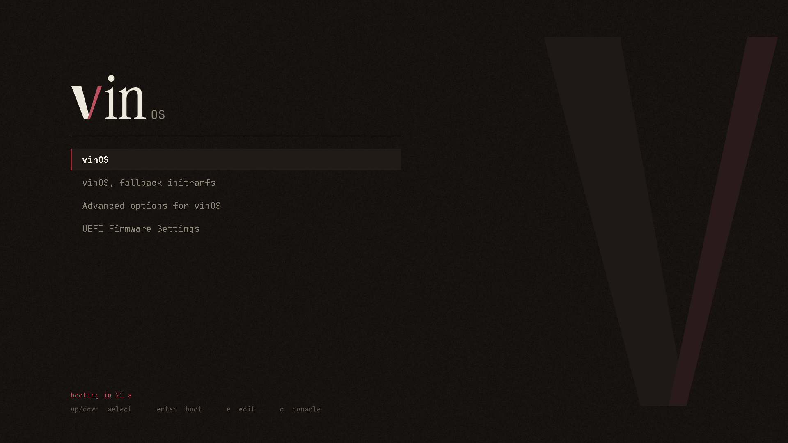
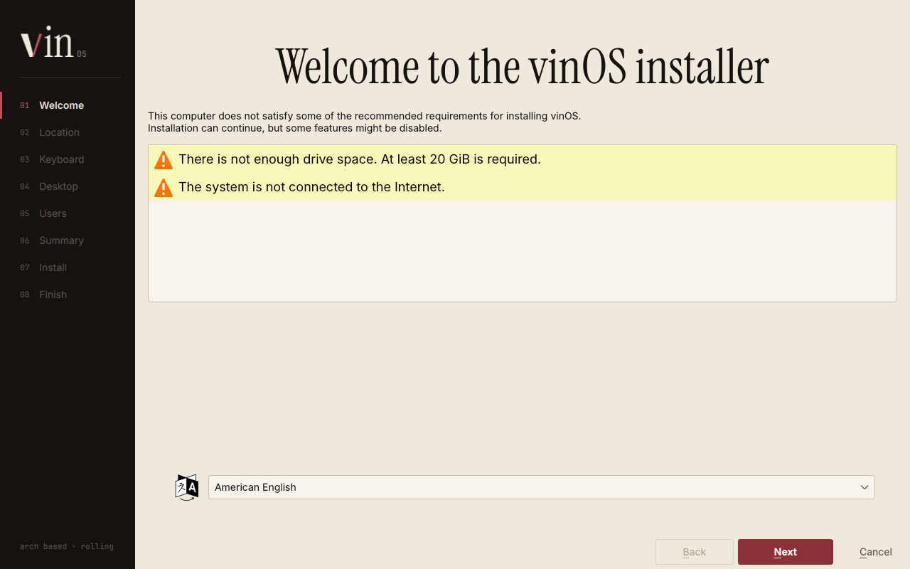
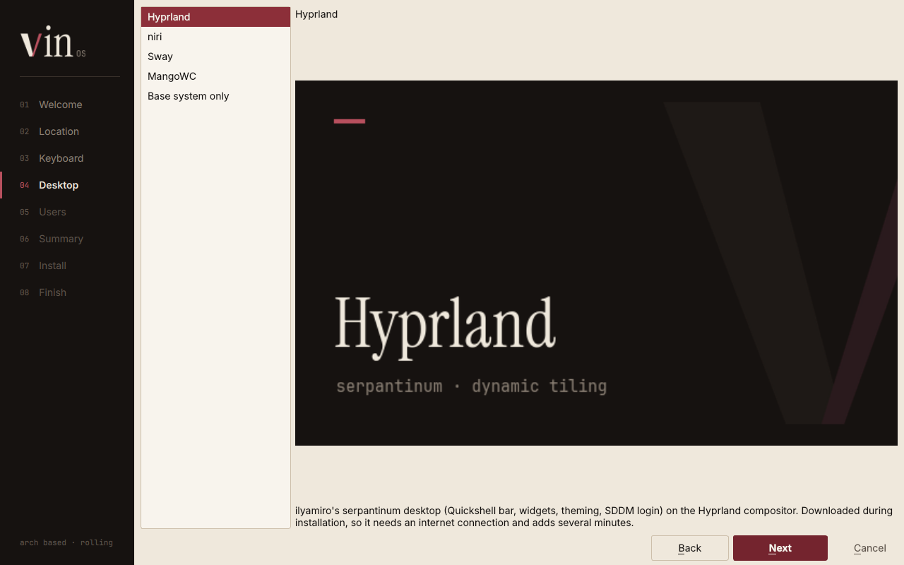

# vinOS

An Arch-based Linux distribution with its own graphical installer, boot theme and fastfetch logo.



| Installer | Desktop choice |
|---|---|
|  |  |

*(The requirement warnings in the welcome screenshot come from the machine they were taken on, which had no disk and no network.)*

## What's here

| Path | What it is |
|---|---|
| `archiso/` | The archiso profile: package list, live root filesystem, BIOS (syslinux) and UEFI (GRUB) boot menus |
| `calamares/` | Installer configuration and the `vinos` branding: stylesheet, sidebar, slideshow, images |
| `grub/themes/vinos/` | GRUB theme, used on the live USB (UEFI) and on installed systems |
| `fastfetch/` | fastfetch config and the vinOS ASCII logo |
| `branding/` | Palette, logo files, fonts |
| `pkg/calamares/` | PKGBUILD for Calamares (not in the official Arch repos) |
| `tools/` | Asset renderers and the Calamares build helper |
| `build.sh` | Builds the ISO |
| `.github/workflows/build.yml` | Builds the ISO on GitHub |

## Getting an ISO

### On GitHub (no Arch machine needed)

1. Push this repository to GitHub.
2. Open the **Actions** tab. The *Build ISO* workflow runs on every push to `main` (you can also start it by hand with *Run workflow*).
3. When it finishes, download `vinos-iso` from the run's **Artifacts** section. It's a zip containing the `.iso` and its `.sha256`.

To publish a release, push a tag. The workflow attaches the ISO to a GitHub Release:

```bash
git tag v2026.11
```

```bash
git push origin v2026.11
```

A build takes roughly 30–60 minutes, most of it compiling Calamares.

### Locally, on Arch

```bash
sudo pacman -S --needed archiso grub git base-devel
```

```bash
sudo bash build.sh
```

The ISO is written to `out/`. Intermediate files go to `work/` (safe to delete).

### Trying it in a VM

```bash
run_archiso -u -i out/vinos-*.iso
```

(`run_archiso` comes with the `archiso` package; `-u` boots UEFI so you see the GRUB theme. Drop `-u` for the BIOS menu.)

## How the install works

The live USB boots straight into the installer: root is logged in automatically on tty1, which starts Calamares full-screen inside `cage` (a single-window Wayland kiosk). Ctrl+Alt+F2 gives a plain root shell.

Calamares copies the live root filesystem to disk, then `vinos-postinstall` removes the live-session bits (autologin, the archiso initramfs hooks, the installer itself) and sets up the pacman keyring. After that come the initramfs, users, services and GRUB with the vinOS theme. The base system installs without a network connection.

### Desktop: serpantinum, installed hands-free

The installer's **Desktop** page offers [serpantinum](https://github.com/ilyamiro/serpantinum) by ilyamiro on Hyprland (the default), niri, Sway or MangoWC, or a plain base system. That click is the only input: the desktop is downloaded and set up during the install, with no terminal menu and no prompts.

This is done by **`vinos-desktop`** (`archiso/airootfs/usr/local/bin/vinos-desktop`), vinOS's edition of serpantinum's `install/install.sh`. It's a modified copy under the same licence (AGPL-3.0-or-later), with ilyamiro's copyright kept. Changes from upstream, also listed in the file header:

- **No interactive menu.** The compositor comes from `--compositor`, then from what's already installed, then Hyprland. Wallpapers: full pack. Login manager: SDDM.
- **No telemetry.** The calls are removed, not just switched off.
- **vinOS is a supported distribution**, so the upstream "unsupported OS" check passes.
- **Pinned upstream version.** It checks out a reviewed serpantinum commit (`VINOS_SERPANTINUM_REF`) instead of `master`; `--ref master` overrides it.
- **No completion screen or restart prompt.** Output is plain log lines.

It stays installed, so users update or switch compositor themselves:

```bash
vinos-desktop
```

```bash
vinos-desktop --compositor niri
```

During installation, `vinos-serpantinum` runs it inside the new system as the new user, with temporary passwordless sudo. That step runs after the bootloader is installed, so a failure can't leave the machine unbootable. If it fails (no network, a package error), the install still finishes, `/var/log/vinos-serpantinum.log` has the details, and the login screen says to run `vinos-desktop`.

It needs internet and takes a while: about 80 packages, some built from the AUR. The base-system option installs offline.

**Updating the pinned commit:** diff upstream's `install/install.sh` against `vinos-desktop`, carry over any new steps, then bump `VINOS_SERPANTINUM_REF`.

## Changing the look

All colours come from `branding/palette.py`. After editing it:

```bash
python3 tools/render_branding.py
```

```bash
python3 tools/render_ascii.py > fastfetch/vinos.txt
```

These regenerate every PNG (GRUB, syslinux splash, installer images, logos) and the fastfetch logo. `stylesheet.qss`, `calamares-sidebar.qml`, `show.qml`, `theme.txt` and the syslinux config use the same hex values written out by hand; grep for the old value.

GRUB fonts are bitmap `.pf2` files. To change the font or size:

```bash
grub-mkfont -s 22 -o grub/themes/vinos/jetbrains-mono-22.pf2 branding/fonts/JetBrainsMono-Regular.ttf
```

## Testing status

What has been run, and what hasn't:

- **GRUB theme:** rendered by real GRUB 2.12 booted in QEMU; the screenshot above is from that.
- **Installer pages:** rendered by a real Calamares 3.3 binary with this config and branding. The screenshots are from that.
- **Slideshow:** rendered through Calamares' slideshow QML module.
- **Shell scripts:** pass `shellcheck`.
- **`build.sh`:** assembly of the profile tested.
- **`vinos-desktop`:** run as a normal user against a vinOS `os-release`, up to the point where it installs packages. Covered: the distro check, compositor selection and defaults, rejection of unknown compositors and non-Arch systems, telemetry off, pinned commit.
- **Not run yet:** `mkarchiso`, the Calamares PKGBUILD build, a full end-to-end install, and serpantinum's package and config steps. All of these need an Arch host. The first GitHub Actions run is the real test of the ISO build; after that, do a test install in a VM before handing the ISO to anyone.

## Licences

- Instrument Serif and JetBrains Mono: SIL Open Font License (see `branding/fonts/`).
- Calamares: GPL-3.0-or-later.
- serpantinum: see its repository.
- Boot configs in `archiso/`: derived from archiso's `releng` profile (GPL-3.0-or-later).
